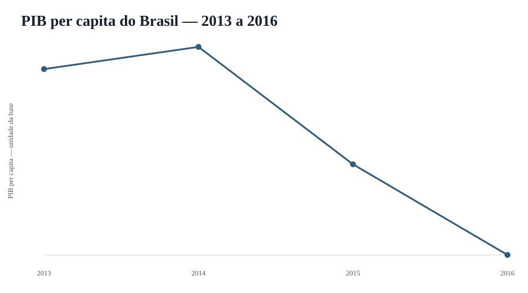
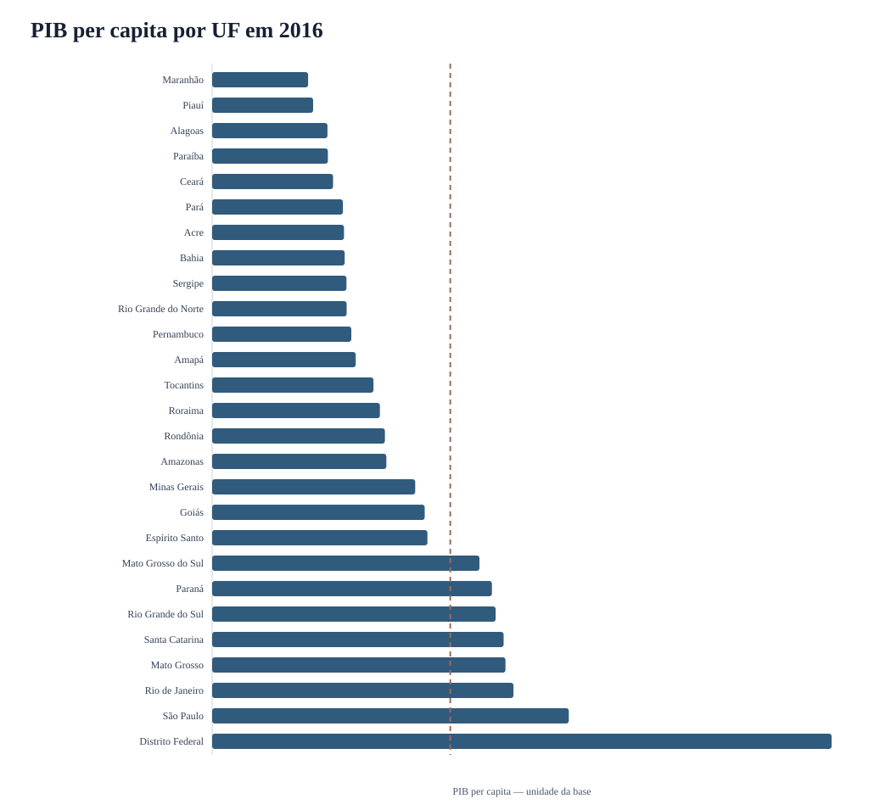
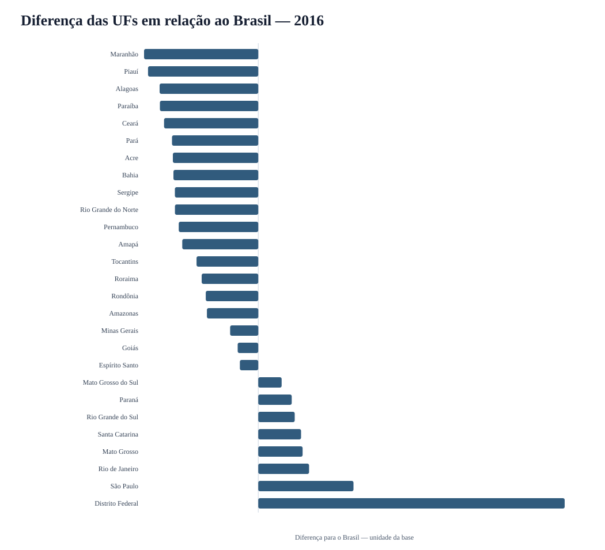
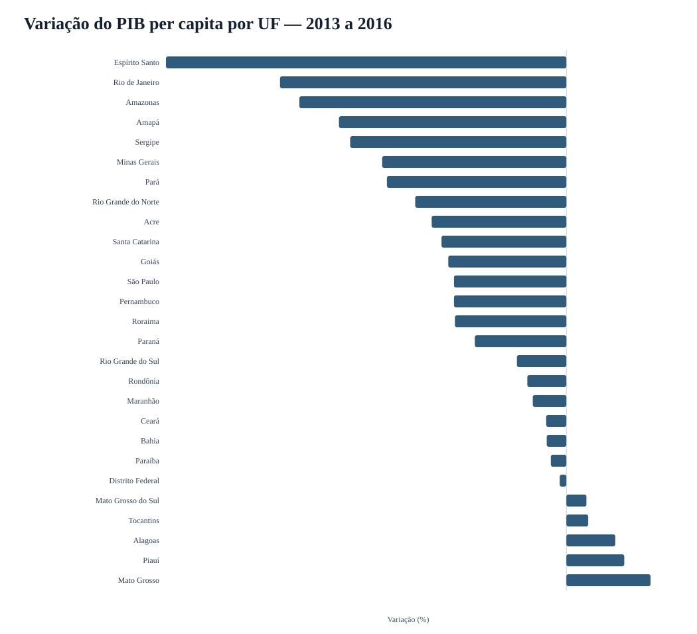
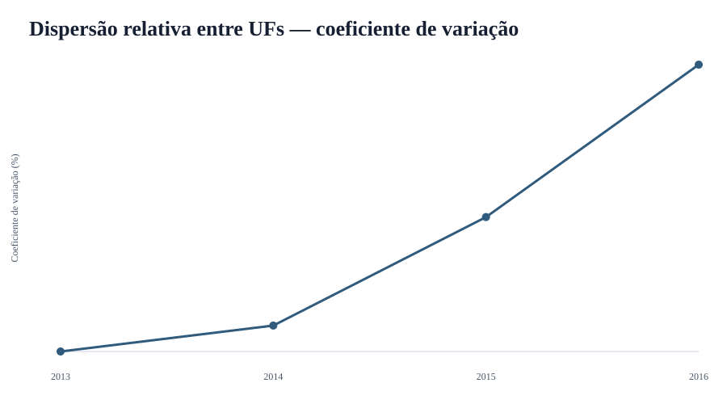

# PIB per Capita no Brasil — Análise Territorial com Python

Projeto de portfólio em **Análise de Dados com Python** sobre a evolução e as diferenças territoriais do PIB per capita entre Brasil e Unidades da Federação, de 2013 a 2016.

## Pergunta central

**Como o PIB per capita varia entre as UFs brasileiras entre 2013 e 2016 e como essas diferenças territoriais se comportam em relação ao valor nacional?**

A análise é descritiva e comparativa. O dataset não contém variáveis suficientes para atribuir causas às diferenças observadas.

## Dataset

A base possui **112 observações**, **28 territorialidades** (Brasil + 27 UFs), quatro anos (2013–2016), nenhum valor ausente e nenhuma duplicata território-ano.

> A planilha original não documenta formalmente a unidade monetária e a escala dos valores. Por isso, o projeto usa **“unidade da base”**.

## Evolução do Brasil

O valor nacional passa de **22,20 em 2013 para 20,19 em 2016**, variação de aproximadamente **−9,05%**.



## Ranking territorial em 2016

O **Distrito Federal** apresenta o maior valor entre as UFs (**52,52**), seguido por São Paulo (**30,24**) e Rio de Janeiro (**25,55**). O **Maranhão** apresenta o menor (**8,14**).



## UFs em relação ao Brasil

Em 2016, **8 UFs** estão acima do valor Brasil e **19** abaixo.



## Variação 2013–2016

Apenas **5 UFs** apresentam crescimento e **22 UFs** apresentam queda.



Maiores altas: Mato Grosso (+6,01%), Piauí (+4,14%), Alagoas (+3,49%), Tocantins (+1,56%) e Mato Grosso do Sul (+1,43%).

Maiores quedas: Espírito Santo (−28,60%), Rio de Janeiro (−20,45%), Amazonas (−19,07%), Amapá (−16,24%) e Sergipe (−15,44%).

## Dispersão territorial

O coeficiente de variação entre UFs passa de aproximadamente **52,7% em 2013 para 54,5% em 2016**.



## Estrutura

```text
├── .github/workflows/python-tests.yml
├── data/raw/pib_per_capita_brasil_2013_2016.csv
├── notebooks/brazil_gdp_per_capita_analysis.ipynb
├── reports/
│   ├── figures/
│   ├── methodology.md
│   └── summary.json
├── src/
│   ├── analysis.py
│   └── data_cleaning.py
├── tests/test_data_cleaning.py
├── requirements.txt
└── README.md
```

## Execução

```bash
pip install -r requirements.txt
python -m src.analysis
pytest -q
```

## Tecnologias

Python · Pandas · Matplotlib · Jupyter Notebook · Pytest · GitHub Actions

## Limitações

- apenas quatro anos de observação;
- ausência de variáveis explicativas;
- unidade monetária/escala não documentada no próprio arquivo;
- análise descritiva, sem inferência causal;
- a linha Brasil é tratada como valor nacional fornecido pela fonte, e não como média das UFs.

## Autor

**Pablo Sena**  
GitHub: [@pablosena28](https://github.com/pablosena28)
